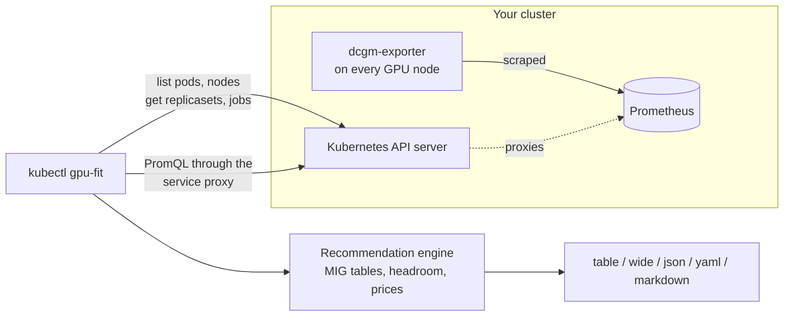

# kubectl gpu-fit

**Goldilocks for GPUs: find out what each Kubernetes workload really needs from its GPU, and what the rest costs you, using the DCGM metrics you already collect.**

[](https://github.com/cb-Sigma/kubectl-gpu-fit/actions/workflows/ci.yml)
[](https://goreportcard.com/report/github.com/cb-Sigma/kubectl-gpu-fit)
[](go.mod)
[](LICENSE)

`kubectl gpu-fit` is a read-only kubectl plugin. It joins the NVIDIA DCGM exporter metrics in your Prometheus with the GPU requests of your running pods and tells you, per workload, whether to keep the GPU, move to a MIG slice, share it, pick a smaller model, or give it back.

<!-- BEGIN output: --demo -->
```console
$ kubectl gpu-fit --demo
NAMESPACE     WORKLOAD           REQUESTED             PEAK MEM   AVG UTIL   RECOMMENDATION            WASTE/MO
ml-serving    embed-api (x4)     1x A100               6.1 GB     9%         MIG 1g.10gb slice         $13,000
notebooks     notebook-priya     1x A100               0.3 GB     0%         idle 7+ days, reclaim     $3,700
ml-serving    rerank-api (x2)    1x T4                 3.2 GB     6%         time-slice, 3 per GPU     $520
vision        ocr-worker (x2)    1x A10                13 GB      12%        smaller GPU: L4 (24 GB)   $380
ml-serving    llm-gateway (x2)   1x H100               62 GB      34%        keep as is                -
ml-serving    tagger (x3)        1x A100 MIG 3g.40gb   17 GB      -          keep as is                -
ml-training   train-nightly      4x H100               71 GB      85%        keep as is                -
research      eval-sweep         2x A100               22 GB      18%        low utilization, review   -
sandbox       cuda-debug         1x GPU                -          -          no data                   -

9 workloads, 19.5 GPUs, est. cost $77,000/mo, est. waste $17,000/mo (23%)
Window 7d, memory headroom 20%, all namespaces. Costs are estimates from rough on-demand list prices per GPU-hour; override with --price or --price-file.
```
<!-- END output -->

That is real output of the binary, from the sample data bundled behind `--demo` (a test keeps this README in sync). Try it yourself without a cluster:

```sh
go install github.com/cb-Sigma/kubectl-gpu-fit@latest
kubectl gpu-fit --demo
```

## Contents

- [Why](#why)
- [Install](#install)
- [Quick start](#quick-start)
- [How it works](#how-it-works)
- [Recommendation rules](#recommendation-rules)
- [Cost estimates](#cost-estimates)
- [Output formats](#output-formats)
- [Flags](#flags)
- [Permissions and security](#permissions-and-security)
- [Limitations](#limitations)
- [FAQ](#faq)
- [Roadmap](#roadmap)
- [Contributing](#contributing)

## Why

GPUs are requested in whole units. An embedding service that needs 6 GB of memory and a tenth of the compute still holds an entire 80 GB card, and a notebook someone opened last week holds one while doing nothing. CPU and memory have had right-sizing tools for years (VPA, Goldilocks); for GPUs the answer usually lives in a Grafana dashboard that somebody has to read, workload by workload, and then translate by hand into "would this fit a `1g.10gb` slice?".

If you run the NVIDIA GPU Operator (or dcgm-exporter on its own), the data to answer that is already in your Prometheus. `kubectl gpu-fit` does the reading and the translating:

- **No agent, no CRDs, nothing installed in the cluster.** One binary on your laptop, read-only API calls.
- **No port-forward.** It finds your Prometheus Service and queries it through the Kubernetes API server.
- **Concrete targets, not just utilization numbers.** It knows the MIG profiles of each GPU model and only suggests one that peak memory plus headroom actually fits.
- **Conservative by design.** Anything it cannot verify is reported as "keep as is", and every recommendation can explain itself (`--explain`).

## Install

**With Go** (1.24 or newer):

```sh
go install github.com/cb-Sigma/kubectl-gpu-fit@latest
```

This puts `kubectl-gpu-fit` in `$(go env GOPATH)/bin`. As long as that directory is on your `PATH`, kubectl picks it up as `kubectl gpu-fit`.

**From source:**

```sh
git clone https://github.com/cb-Sigma/kubectl-gpu-fit.git
cd kubectl-gpu-fit
make build                          # static binary in bin/
sudo install bin/kubectl-gpu-fit /usr/local/bin/
```

**Release binaries:** every `v*` tag is built by [GoReleaser](.goreleaser.yaml) for Linux, macOS and Windows (amd64 and arm64) and attached to the [Releases](https://github.com/cb-Sigma/kubectl-gpu-fit/releases) page with checksums. Unpack the archive and put `kubectl-gpu-fit` on your `PATH`.

**Krew:** planned. There is no krew manifest yet, so `kubectl krew install gpu-fit` does not work today.

Check the installation:

```sh
kubectl plugin list | grep gpu-fit
kubectl gpu-fit version
```

## Quick start

You need a cluster where [dcgm-exporter](https://github.com/NVIDIA/dcgm-exporter) is scraped by Prometheus. That is the default with the NVIDIA GPU Operator plus kube-prometheus-stack, and with most managed GPU offerings once GPU monitoring is enabled.

```sh
# Current namespace, last 7 days
kubectl gpu-fit

# Whole cluster
kubectl gpu-fit -A

# Longer window, with the reasoning behind every line
kubectl gpu-fit -A --window 14d --explain

# Only what is worth acting on
kubectl gpu-fit -A --min-waste 1000

# Use what you actually pay
kubectl gpu-fit -A --price a100=3.67 --price h100=4.25
```

If your Prometheus is not found automatically, name it, or point at any Prometheus-compatible URL:

```sh
kubectl gpu-fit -A --prometheus-service monitoring/prometheus-k8s:9090
kubectl gpu-fit -A --prometheus-url https://prometheus.example.com
```

`--explain` shows why each recommendation was made and what else would fit:

<!-- BEGIN output: --demo --explain --min-waste 3000 -->
```console
$ kubectl gpu-fit --demo --explain --min-waste 3000
NAMESPACE    WORKLOAD         REQUESTED   PEAK MEM   AVG UTIL   RECOMMENDATION          WASTE/MO
ml-serving   embed-api (x4)   1x A100     6.1 GB     9%         MIG 1g.10gb slice       $13,000
notebooks    notebook-priya   1x A100     0.3 GB     0%         idle 7+ days, reclaim   $3,700

ml-serving/embed-api (Deployment)
  recommendation: MIG 1g.10gb slice
  why:            Peak memory 6.1 GB (+20% headroom = 7.3 GB) fits the 1g.10gb slice of the A100 80GB, and p95 utilization 12% fits its 1/7 of compute. Up to 7 such slices share one GPU.
  alternatives:   time-slice, 4 per GPU; smaller GPU: A10 (24 GB)
  cost:           $15,000/mo at $5.07 per GPU-hour, est. waste $13,000/mo

notebooks/notebook-priya (Pod)
  recommendation: idle 7+ days, reclaim
  why:            GPU utilization has not exceeded 5% for the whole 7 days it was observed (it still holds up to 0.3 GB of GPU memory). The GPU can be reclaimed, e.g. by scaling the workload to zero.
  cost:           $3,700/mo at $5.07 per GPU-hour, est. waste $3,700/mo

9 workloads, 19.5 GPUs, est. cost $77,000/mo, est. waste $17,000/mo (23%)
Showing 2 of 9 workloads (filtered by --min-waste).
Window 7d, memory headroom 20%, all namespaces. Costs are estimates from rough on-demand list prices per GPU-hour; override with --price or --price-file.
```
<!-- END output -->

## How it works



1. **Pods.** Lists running pods that request `nvidia.com/gpu`, `nvidia.com/gpu.shared` or `nvidia.com/mig-*`, and groups them into workloads by owner: Deployment (via ReplicaSet), StatefulSet, DaemonSet, CronJob (via Job), Job, a custom controller, or the bare pod.
2. **Prometheus.** Uses `--prometheus-url` if given. Otherwise it looks for a Prometheus Service (kube-prometheus-stack, prometheus-operator, the community Helm chart and similar naming) and queries it through the API server's service proxy, so the only network path you need is the one kubectl already uses.
3. **Metrics.** For the chosen `--window` it asks for `avg_over_time`, `max_over_time` and `quantile_over_time(0.95, ...)` of GPU utilization and framebuffer memory, the most recent time utilization exceeded the idle threshold, and how much of the window has data at all. That is a fixed number of instant queries, about twenty (ten more when MIG instances lack a utilization metric), regardless of cluster size.
4. **Join.** Each DCGM series names the pod that holds the GPU. Both label conventions are understood: `pod` / `namespace` / `container`, and `exported_pod` / `exported_namespace` / `exported_container` (what you get when Prometheus scrapes dcgm-exporter without `honorLabels`).
5. **Recommend.** A pure function turns each workload's usage into a recommendation (rules below) and a cost estimate.

Metric names from both generations of dcgm-exporter are queried, since release 4.9.0 renamed the defaults and changed their units:

| Quantity | Up to dcgm-exporter 4.8 | dcgm-exporter 4.9 and later |
| --- | --- | --- |
| GPU utilization | `DCGM_FI_DEV_GPU_UTIL` (percent) | `DCGM_FI_DEV_GPU_UTIL_RATIO` (0-1) |
| Memory used | `DCGM_FI_DEV_FB_USED` (MiB) | `DCGM_FI_DEV_FB_USED_BYTES` |
| Memory free | `DCGM_FI_DEV_FB_FREE` (MiB) | `DCGM_FI_DEV_FB_FREE_BYTES` |
| Memory reserved | `DCGM_FI_DEV_FB_RESERVED` (MiB) | `DCGM_FI_DEV_FB_RESERVED_BYTES` |
| Memory capacity | derived: used + free + reserved | `DCGM_FI_DEV_FB_CAPACITY_BYTES` |
| Utilization of MIG instances (fallback) | `DCGM_FI_PROF_GR_ENGINE_ACTIVE` | `DCGM_FI_PROF_GR_ENGINE_UTIL_RATIO` |

The GPU model comes from DCGM's `modelName` label, falling back to the `nvidia.com/gpu.product` node label set by GPU Feature Discovery.

## Recommendation rules

Rules are checked top to bottom; the first that applies wins. "Required memory" is peak memory over the window plus `--headroom` (default 20%). Workloads are judged by their worst replica: peak memory and p95 utilization are the maximum across all replicas and GPUs.

| # | Condition | Recommendation | Waste counted |
| --- | --- | --- | --- |
| 1 | No DCGM series for the workload's pods | `no data` | none |
| 2 | Less than `--min-observation` (1h) of metrics | `not enough data` | none |
| 3 | Utilization metric missing (typical for MIG instances) | `keep as is` | none |
| 4 | Utilization never above `--idle-util` (5%) during the last `--idle-after` (24h), on every replica, with at least that much history | `idle <duration>, reclaim` | 100% |
| 5 | Already on a MIG slice or a shared GPU and in use, or memory metric missing | `keep as is` | none |
| 6 | More than one GPU per pod, p95 utilization below 50% | `low utilization, review` | none (no safe automatic target) |
| 7 | More than one GPU per pod, otherwise | `keep as is` | none |
| 8 | A partial MIG profile of this GPU model holds the required memory, and p95 utilization fits within 90% of the profile's compute share | `MIG <profile> slice` (smallest that fits) | 1 - the profile's share of the GPU |
| 9 | Required memory and p95 utilization leave room for N >= 2 such workloads on the card (N capped by `--max-time-slice`, default 4) | `time-slice, N per GPU` | 1 - 1/N |
| 10 | A cheaper model has enough memory, and projected p95 utilization on it stays under 50% | `smaller GPU: <model>` | price difference |
| 11 | None of the above | `keep as is` | none |

Notes on the choices:

- **Preference order.** MIG comes first because it keeps your hardware and gives real memory and fault isolation. Time-slicing keeps the hardware but has no memory isolation. A different GPU model means new nodes. Other options that also fit are listed under "alternatives" in `--explain`. Use `--strategies` to turn any of the three off or restrict the search, for example `--strategies mig`.
- **MIG profiles** follow the [NVIDIA MIG User Guide](https://docs.nvidia.com/datacenter/tesla/mig-user-guide/supported-mig-profiles.html) for A30, A100 40GB/80GB, H100 80GB/94GB, H200 and B200. Run `kubectl gpu-fit models` to see the table. Profile sizes are treated as decimal gigabytes, which slightly understates what a slice really offers, so a fit is never overstated.
- **A profile's share of the GPU** is the larger of its memory fraction and its compute fraction: `1g.10gb` on an 80 GB card is 1/7, `1g.20gb` is 1/4, `3g.40gb` is 1/2.
- **Idle time** is how long ago utilization last exceeded the threshold. If that never happened inside the window, it is shown as a lower bound (`idle 7+ days`); a longer `--window` will tell you more.
- **Smaller GPU model** uses a coarse built-in relative-throughput index (for instance A100 = 1.0, L4 = 0.15) and therefore demands a 2x margin. Treat it as a pointer to investigate, not a benchmark.

## Cost estimates

`WASTE/MO` is the share of the workload's GPU spend that the recommendation would free up: `hourly price x 730 hours x GPUs x (1 - share still needed)`.

The built-in prices are **rough on-demand list-price estimates in USD per GPU-hour**, good enough to rank workloads and nothing more. Real prices differ a lot between providers, regions, commitments and on-prem amortization. Use your own:

```sh
kubectl gpu-fit -A --price a100=3.67 --price h100-94gb=6.10
kubectl gpu-fit -A --price-file examples/prices.yaml
kubectl gpu-fit models --price-file examples/prices.yaml   # check what is in effect
```

A family name such as `a100` sets every memory variant; a full key such as `a100-80gb` sets one. Amounts in the table are rounded to two significant digits on purpose; `-o json` has the unrounded numbers.

<!-- BEGIN output: models -->
```console
$ kubectl gpu-fit models
MODEL       GPU         MEMORY   USD/HOUR   PRICE SOURCE        MIG PROFILES
a10         A10         24 GB    1.01       built-in estimate   -
a100-40gb   A100 40GB   40 GB    3.67       built-in estimate   1g.5gb, 1g.10gb, 2g.10gb, 3g.20gb, 4g.20gb, 7g.40gb
a100-80gb   A100 80GB   80 GB    5.07       built-in estimate   1g.10gb, 1g.20gb, 2g.20gb, 3g.40gb, 4g.40gb, 7g.80gb
a30         A30         24 GB    1.10       built-in estimate   1g.6gb, 2g.12gb, 4g.24gb
a40         A40         48 GB    1.30       built-in estimate   -
b200        B200        180 GB   14.00      built-in estimate   1g.23gb, 1g.45gb, 2g.45gb, 3g.90gb, 4g.90gb, 7g.180gb
h100        H100 80GB   80 GB    9.80       built-in estimate   1g.10gb, 1g.20gb, 2g.20gb, 3g.40gb, 4g.40gb, 7g.80gb
h100-94gb   H100 94GB   94 GB    9.80       built-in estimate   1g.12gb, 1g.24gb, 2g.24gb, 3g.47gb, 4g.47gb, 7g.94gb
h200        H200        141 GB   10.60      built-in estimate   1g.18gb, 1g.35gb, 2g.35gb, 3g.71gb, 4g.71gb, 7g.141gb
l4          L4          24 GB    0.75       built-in estimate   -
l40         L40         48 GB    1.60       built-in estimate   -
l40s        L40S        48 GB    1.86       built-in estimate   -
t4          T4          16 GB    0.53       built-in estimate   -
v100        V100 16GB   16 GB    3.06       built-in estimate   -
v100-32gb   V100 32GB   32 GB    3.06       built-in estimate   -
```
<!-- END output -->

## Output formats

| `-o` | Use |
| --- | --- |
| `table` (default) | Compact, colored on a terminal. Honours `NO_COLOR`; force with `--color always` or `never`. |
| `wide` | Adds kind, full GPU model, p95 and max utilization, observed time, monthly cost and the reasoning. |
| `json`, `yaml` | Everything, unrounded, for scripts and dashboards. |
| `markdown` | A table to paste into an issue, a pull request or a wiki page. Add `--explain` for a "Why" column. |

Sort with `--sort-by waste|name|namespace|util|mem|gpus` and filter with `--min-waste`. The footer always totals every analysed workload, including filtered ones.

```sh
# The three most wasteful workloads as JSON
kubectl gpu-fit -A -o json | jq '.rows[:3][] | {namespace, workload, summary: .recommendation.summary, monthlyWasteUSD}'
```

## Flags

The standard kubectl connection flags work as usual (`--kubeconfig`, `--context`, `-n/--namespace`, `--as`, `--server`, ...). Run `kubectl gpu-fit --help` for the full list.

| Flag | Default | Meaning |
| --- | --- | --- |
| `-A`, `--all-namespaces` | off | Analyse every namespace instead of the current one. |
| `--window` | `7d` | How far back to look. Accepts `36h`, `7d`, `2w`, `1d12h`. |
| `--headroom` | `20%` | Safety margin on peak memory. `20%` or `0.2`. |
| `--idle-after` | `24h` | How long a GPU must be unused before it is reported idle. |
| `--idle-util` | `5` | Utilization (percent) at or below which a GPU counts as unused. |
| `--min-observation` | `1h` | Minimum metric history before a recommendation is made. |
| `--strategies` | `mig,time-slice,downsize` | Strategies to consider. `none` only reports idle GPUs. |
| `--max-time-slice` | `4` | Upper bound on workloads suggested per time-sliced GPU. |
| `--resolution` | `5m` | Step used to measure coverage and idle time. |
| `--prometheus-url` | | Prometheus-compatible base URL. Also read from `GPU_FIT_PROMETHEUS_URL`. |
| `--prometheus-service` | | In-cluster Service as `[https:]namespace/name[:port]`; skips discovery. |
| `--prometheus-token-file` | | Bearer token file for `--prometheus-url`. |
| `--price` | | `model=usd-per-hour`, repeatable. |
| `--price-file` | | YAML price table, see [examples/prices.yaml](examples/prices.yaml). |
| `-o`, `--output` | `table` | `table`, `wide`, `json`, `yaml`, `markdown`. |
| `--sort-by` | `waste` | `waste`, `name`, `namespace`, `util`, `mem`, `gpus`. |
| `--min-waste` | `0` | Hide workloads below this estimated monthly waste (USD). |
| `--explain` | off | Print the reasoning for every row. |
| `--color` | `auto` | `auto`, `always`, `never`. |
| `--timeout` | `2m` | Overall time limit. |
| `--demo` | off | Report from bundled sample data, no cluster needed. |

Subcommands: `kubectl gpu-fit models` (GPU catalog and prices in effect) and `kubectl gpu-fit version`.

## Permissions and security

`kubectl gpu-fit` only reads. It never creates, patches or deletes anything, and the test suite asserts that it sends nothing but `get` and `list` requests.

| Resource | Verb | Needed for |
| --- | --- | --- |
| `pods` | `list` | Finding GPU workloads. Required. |
| `replicasets` (apps), `jobs` (batch) | `get` | Naming Deployments and CronJobs. Optional: without it names are inferred from pod owners. |
| `nodes` | `list` | GPU model and sharing labels from GPU Feature Discovery. Optional. |
| `services` | `list` | Finding Prometheus. Not needed with `--prometheus-url` or `--prometheus-service`. |
| `services/proxy` | `get` | Querying an in-cluster Prometheus through the API server. Not needed with `--prometheus-url`. |

[deploy/rbac.yaml](deploy/rbac.yaml) contains exactly that as a ClusterRole plus a namespaced Role that restricts `services/proxy` to the one Prometheus Service by name:

```sh
kubectl apply -f deploy/rbac.yaml
kubectl create clusterrolebinding gpu-fit-alice --clusterrole=kubectl-gpu-fit --user=alice@example.com
kubectl -n monitoring create rolebinding gpu-fit-alice --role=kubectl-gpu-fit-prometheus --user=alice@example.com
```

Worth knowing: `services/proxy` lets the holder send HTTP GET requests to that Service, so anyone you grant it to can read everything in that Prometheus. If that is too broad, expose Prometheus another way and use `--prometheus-url`.

The tool sends nothing anywhere except to your API server and your Prometheus. No telemetry.

## Limitations

Being upfront about what this does not do yet, or cannot know:

- **Maturity.** This is a young project. Its test suite runs against a fake Prometheus, the client-go fake clientset and an HTTP imitation of the API server; it has also been run by hand against a real kube-apiserver; and its metric and label handling follows the dcgm-exporter source. It has not been battle-tested on real GPU clusters yet. If the output looks wrong on yours, please [open an issue](https://github.com/cb-Sigma/kubectl-gpu-fit/issues/new/choose) with one sample DCGM series.
- **Only what DCGM attributes to a pod is visible.** dcgm-exporter must run with Kubernetes pod attribution (the GPU Operator default). On time-sliced GPUs it attributes a device to one pod unless virtual GPU reporting is enabled, so the other pods sharing it show `no data`.
- **Memory on shared GPUs is per device, not per pod.** On a time-sliced GPU every pod sharing it is shown the device's total. That errs on the safe side.
- **Utilization is not memory bandwidth or throughput.** "GPU utilization" is the share of time a kernel was running. A workload at 30% may still need a full GPU's speed for latency reasons; the p95-based rules and the margins try to respect that, your SLOs know better.
- **MIG instances often have no utilization metric.** `DCGM_FI_DEV_GPU_UTIL` is generally not available per MIG instance. The profiling metric is used when present; otherwise such workloads are left alone.
- **Multi-GPU pods get no automatic target.** Going from 4 GPUs to 2 is a code change, not a scheduling change.
- **Only running pods count.** Finished Jobs and scaled-to-zero workloads do not appear, and cost is extrapolated from what is running now.
- **NVIDIA only**, via extended resources. Pods that get GPUs through Dynamic Resource Allocation (DRA) claims are not detected yet.
- **Managed Prometheus with request signing** (for example SigV4) is not supported; bearer tokens are.

## FAQ

**Does it change anything in my cluster?**
No. It only issues `get` and `list` requests and PromQL queries.

**It says no Prometheus Service was found.**
Discovery looks for Services that look like Prometheus (label `app.kubernetes.io/name=prometheus`, or common names such as `prometheus-k8s`, `prometheus-server`, `kube-prometheus-stack-prometheus`, `prometheus-operated`) with port 9090 or a port named `web`, `http-web` or `http`. Name yours with `--prometheus-service namespace/name:port`, or use `--prometheus-url`.

**Does it work with Thanos, Mimir, VictoriaMetrics?**
Anything that serves the Prometheus `/api/v1/query` API and supports subqueries should work through `--prometheus-url`. Only Prometheus itself is covered by tests today.

**Every workload shows `no data`.**
Either Prometheus has no DCGM metrics for the window (the tool warns about that), or the series carry no pod labels. Check one: `DCGM_FI_DEV_GPU_UTIL` (or `..._RATIO`) should have `pod` and `namespace`, or `exported_pod` and `exported_namespace`, labels naming your workload.

**Why "GB" for memory when DCGM reports MiB?**
Figures are binary gigabytes (MiB / 1024) labelled GB, the way `nvidia-smi` users read them. JSON and YAML carry MiB.

**Why did my 9 GB workload not get a `1g.10gb` slice?**
With the default 20% headroom it needs 10.8 GB. Lower `--headroom` if you trust the peak.

**A workload is flagged idle but it is a standby replica.**
Then it is idle on purpose, and only you can know that. Raise `--idle-after`, or filter it out downstream using `-o json`.

**How is this different from Goldilocks or VPA?**
Those right-size CPU and memory requests. This does the same job for GPU requests, where the units are whole cards, MIG profiles and time-slices.

**Can it apply the recommendations?**
No, on purpose. Moving a workload to MIG or time-slicing involves node configuration and a rollout that deserve a human.

## Roadmap

Not promises, but the current plan, roughly in order:

- Krew manifest and distribution through a krew index
- Per-container breakdown inside a workload
- Detect GPUs requested through DRA resource claims
- Node-level view: which nodes could be drained if the recommendations were applied
- Optional VictoriaMetrics and Thanos coverage in the test suite
- A `--since-deploy` mode that only looks at metrics after the latest rollout

Ideas and field reports are welcome in the [issues](https://github.com/cb-Sigma/kubectl-gpu-fit/issues).

## Contributing

Contributions are welcome, especially reports from real clusters and corrections to GPU, MIG and price data. See [CONTRIBUTING.md](CONTRIBUTING.md) for how to build, test and try changes against a fake cluster. Please follow the [Code of Conduct](CODE_OF_CONDUCT.md), and report security issues privately as described in [SECURITY.md](SECURITY.md).

## License

[Apache License 2.0](LICENSE). Copyright The kubectl-gpu-fit Authors.

NVIDIA, DCGM and the GPU model names are trademarks of NVIDIA Corporation. This project is not affiliated with or endorsed by NVIDIA.
